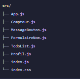
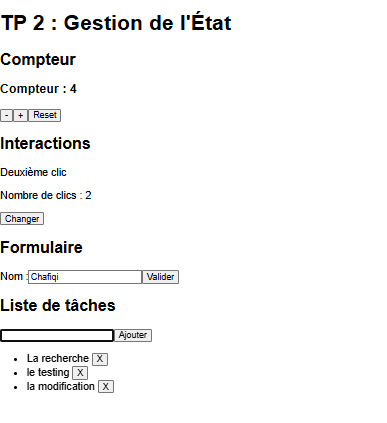
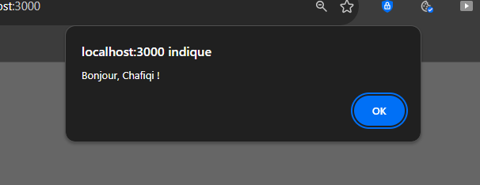

# TP 2 : Gestion de l’état local et interactions utilisateurs avec React

Application React réalisée dans le cadre du deuxième TP. Elle montre comment un composant peut garder des données en mémoire, réagir aux actions de l'utilisateur et mettre à jour l'interface à chaque changement. Tous les composants sont regroupés dans une seule page.

## Ce que le projet démontre

- le stockage de données locales dans un composant avec `useState`
- la mise à jour de l'état avec la forme fonctionnelle `setX(prev => ...)`
- la gestion des événements `onClick`, `onChange` et `onSubmit`
- les formulaires contrôlés, où la valeur du champ est gérée par l'état
- l'affichage et la modification d'une liste de tâches
- l'état sous forme d'objet, mis à jour avec l'opérateur de décomposition `...`

## Prérequis

- Node.js (version LTS, 16 ou plus)
- npm
- un éditeur de code, par exemple Visual Studio Code

Pour vérifier l'installation :

```bash
node -v
npm -v
```

## Installation et lancement

Depuis le dossier du projet :

```bash
npm install
npm start
```

L'application s'ouvre sur `http://localhost:3000`. Si ce n'est pas le cas, il suffit de taper l'adresse dans le navigateur. Pour arrêter le serveur, utiliser `Ctrl + C` dans le terminal.

## Structure du projet



## Les composants

| Composant | Rôle | État utilisé |
|---|---|---|
| `Compteur` | Incrémente, décrémente (sans descendre sous 0) et remet à zéro | `compte` |
| `MessageBouton` | Change le message affiché à chaque clic et compte les clics | `message`, `clics` |
| `FormulaireNom` | Formulaire contrôlé qui affiche une alerte avec le nom saisi | `nom` |
| `TodoList` | Ajout et suppression de tâches | `taches`, `nouvelleTache` |
| `Profil` | Profil utilisateur stocké dans un objet | `user` |

`App.js` assemble les quatre premiers composants dans des sections distinctes. `Profil` est présent dans le dossier `src` mais n'est pas affiché dans la page.

## Exécution

### Affichage de l'application

La page avec le compteur, le message du bouton, le formulaire et la liste de tâches.



### Validation du formulaire

Après la saisie d'un nom et un clic sur Valider, une alerte affiche le message de bienvenue.



#
